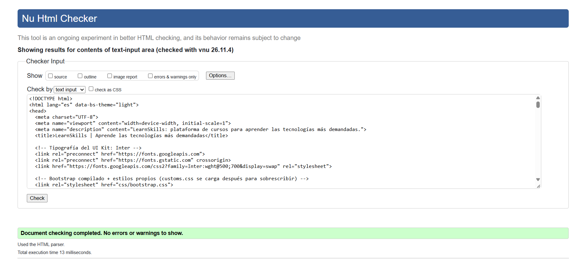
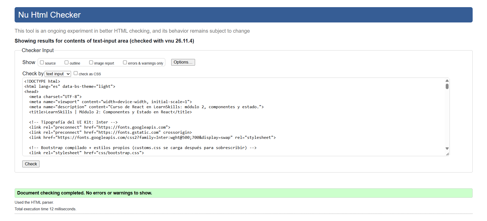
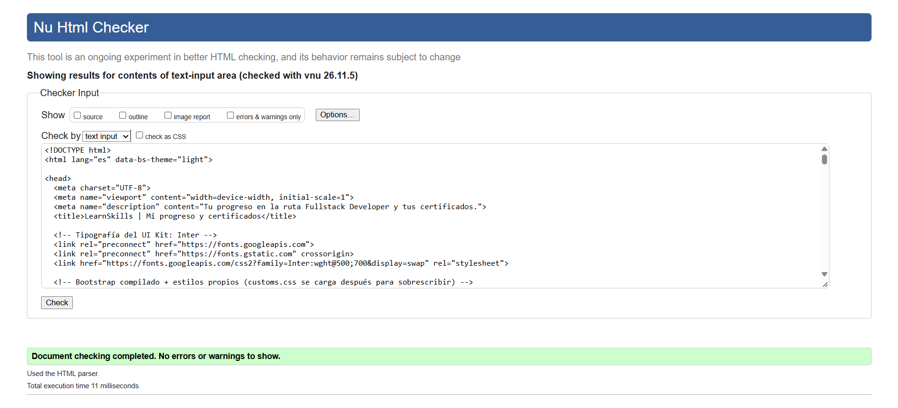
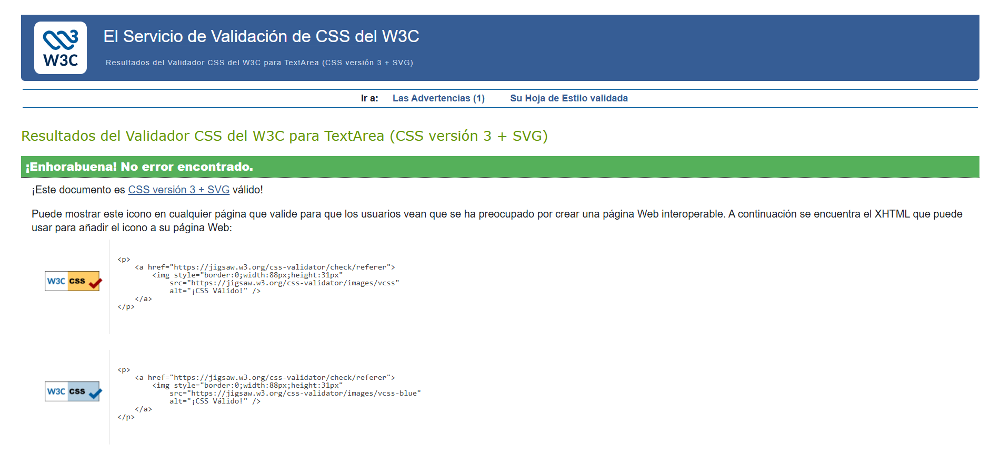

# LearnSkills · Práctica 1 

Maquetación responsive de la interfaz **LearnSkills** (plataforma de cursos) a partir de los mockups de Figma de la práctica anterior. Incluye **modo oscuro**, **formulario de acceso con validación** y código Sass modular sobre **Bootstrap 5.3**.


## Características

- HTML5 semántico (`header`, `nav`, `main`, `section`, `article`, `aside`, `footer`).
- Rejilla de 12 columnas de Bootstrap (escritorio, tablet y móvil con menú hamburguesa).
- Sass modular con variables extraídas del UI Kit (colores, Inter, radios, sombras).
- Override de Bootstrap (botones 160×44, inputs, tarjetas de 12px de radio, estados hover/focus/active).
- Modo oscuro (`data-bs-theme` + variables CSS), guardado en `localStorage` y respeta `prefers-color-scheme`.
- Formulario de **inicio de sesión / registro** con validación (formato de email, longitud y complejidad de contraseña, coincidencia, términos).
- Interacción DOM: buscador de cursos, tarjeta activa, temario con lecciones marcables.


## Estructura

```
├── index.html               ← Desktop-1 / móvil: inicio + cursos destacados
├── curso.html               ← Desktop-2 / móvil: módulo de React + temario
├── progreso.html            ← Desktop-3 / móvil: progreso y certificados
├── css/bootstrap.css · css/customs.css  ← CSS compilado
├── js/script.js             ← tema oscuro, validación y DOM
├── img/                     ← imágenes del diseño
└── scss/
    ├── bootstrap.scss       ← Bootstrap (parciales _*.scss originales)
    └── customs.scss         ← variables UI Kit, base, layout, componentes y modo oscuro
```


## Compilar el Sass

** – VS Code + Live Sass Compiler** (configurado en `.vscode/settings.json`)
1. Instala la extensión *Live Sass Compiler*.
2. Abre `scss/customs.scss` y pulsa **Watch Sass**. Se genera `css/customs.css`.


##  Validación W3C







##  Autor

Elena Chiru · DAW B